# Manual de usuario · Tablero y API de frecuencias

Para el despachador, el supervisor de turno y el analista de operación. Explica qué responde cada pantalla del tablero,
cómo gestionar una alerta, cómo leer una recomendación y cómo usar la API directamente. Cómo instalar y levantar todo:
`../README.md` (API) y `../../dash_app/README.md` (tablero); despliegue con Docker: `despliegue.md`.

## 1. Las cuatro preguntas y dónde se responden

| Quiero saber… | En el tablero | En la API | Qué mirar |
|---|---|---|---|
| Cuántos pasajeros vienen | Pronóstico (arriba: los próximos 30, 60 y 120 minutos) · Recomendaciones | `POST /api/v1/predictions/run` (por omisión, el pronóstico de corto plazo), `GET /api/v1/predictions/corto-plazo/calcular`, `POST /api/v1/predictions/corto-plazo`, `GET /api/v1/predictions` | subidas esperadas por ruta, sentido y segmento, banda P10–P90, líneas base, `model_id`, `modelo` (`corto_plazo` u `horario`) y explicación |
| Cada cuánto despachar | Recomendaciones · Horario | `GET /api/v1/recommendations`, `POST /api/v1/recommendations/calculate`, `GET /api/v1/recommendations/plan` | `headway_min` y `buses_hora` frente a la frecuencia programada (`frecuencia_actual_min`) |
| Cuántos buses necesito | Recomendaciones · Inicio | las mismas y `GET /api/v1/respuesta` | por franja, `vehiculos_requeridos` (⌈ciclo / headway⌉) frente a la flota disponible, y `viable` con su `motivo`; para el día, `vehiculos.requeridos_pico` de la respuesta (los buses en ruta a la vez en el momento más cargado) frente a `flota_disponible` |
| Qué requiere atención ya | Alertas · Operación | `GET /api/v1/alerts?estado=nueva`; las próximas dos horas, en `proximas_dos_horas` de `GET /api/v1/respuesta` | severidad, explicación, observado frente a esperado y umbral, y recomendación; para las próximas dos horas, las subidas a 30, 60 y 120 minutos de cada ruta con su recomendación y los segmentos más cargados |
| Todo lo anterior junto: la pregunta del reto | Inicio (tarjeta «Respuesta a la pregunta del reto») | `GET /api/v1/respuesta` (`ruta`, `fecha` e `instante` opcionales) | por ruta: cada cuánto despachar por hora frente a lo programado, pasajeros esperados con P10–P90, vehículos frente a la flota, flota y recaudo, y las alertas que piden atención, con la trazabilidad (modelo, datos, umbrales); además, las próximas dos horas con el pronóstico de corto plazo (`proximas_dos_horas`) |

Severidades: **crítica** (actuar ahora), **preventiva** (revisar en la hora) e **informativa** (para planear).

## 2. Antes de empezar: clave y rol

Cada persona usa una clave de API que le entrega el administrador (`scripts/crear_api_key.py`). La clave define el
rol, y la API registra en la bitácora al usuario de la clave:

| Rol | Qué puede hacer |
|---|---|
| `operador` | Ver todo y gestionar alertas (reconocer, asignar, comentar, cerrar o descartar). |
| `analista` | Lo anterior, y además lanzar ejecuciones, pedir pronósticos y recomendaciones, entrenar candidatos y pedir el refresco de las estadísticas por segmento. |
| `admin` | Lo anterior, y además activar o revertir modelos, cambiar umbrales, capacidad, flota disponible y tiempo de ciclo (`PUT /api/v1/catalogos/flota`) y correr la retención de datos (`POST /api/v1/retencion/aplicar`). |

El tablero lee la clave de la variable `SOBUSA_API_KEY` y la URL de la API de `SOBUSA_API_URL`. Por ejemplo, en
PowerShell, desde `dash_app/`:

```
$env:SOBUSA_API_URL="http://127.0.0.1:8000"; $env:SOBUSA_API_KEY="<su clave>"; python app.py
```

Después abra http://127.0.0.1:8050. La clave nunca llega al navegador: las exportaciones pasan por el servidor del
tablero.

## 3. El tablero, pantalla por pantalla

Cada pantalla abre con su pregunta en grande y sus controles a la derecha. El botón «…» de cada tarjeta abre la tabla
con los datos del gráfico y sus fuentes. Hay dos grupos de pantallas:

- **Alertas, Recomendaciones, Operación y Monitoreo** consumen la API en vivo, y también la tarjeta «Respuesta a la
  pregunta del reto» de Inicio y las dos primeras secciones de Pronóstico. Si la API no responde, lo dicen («La API no responde en …») y no muestran cifras
  inventadas.
- **El resto** (Inicio, Pronóstico, Horario, Despacho, El modelo, Resultado y Anexos) lee los datos del proyecto que
  vienen con el tablero.

### 3.1 Pronóstico · ¿Cuántos pasajeros subirán en los próximos 30, 60 y 120 minutos?

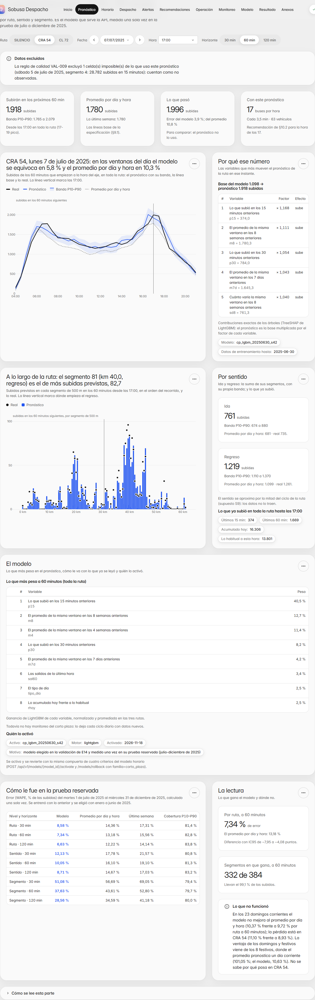

Es lo primero de la pantalla Pronóstico y es lo que pide la especificación (RF-005): con lo que ya subió hoy, cuántos
pasajeros subirán en la próxima media hora, en la próxima hora y en las próximas dos horas, en toda la ruta, en cada
sentido y en cada segmento de 500 m.

1. Elija la ruta, la fecha, la hora y el horizonte (30, 60 o 120 min). Las fechas son las de la prueba reservada
   (julio a diciembre de 2025), que el modelo no vio al entrenar ni al elegirse.
2. Las cuatro fichas de arriba dicen cuántas subidas vienen, con la banda P10–P90 (ocho de cada diez ventanas reales
   caen dentro); el promedio por día y hora, que es la línea base de la especificación; lo que de verdad pasó, solo para
   comparar, porque el pronóstico no lo usa; y la recomendación que sale de ese pronóstico: buses por hora, cada cuántos
   minutos y cuántos vehículos.
3. La curva del día muestra el pronóstico de cada media hora con su banda, el promedio y lo real. La línea vertical es
   la hora elegida.
4. «Por qué ese número» lista las variables que más mueven el pronóstico, con el factor por el que lo multiplican; la
   primera suele ser lo que subió en los 15 minutos anteriores.
5. «A lo largo de la ruta» muestra las subidas previstas en cada segmento, en el orden del recorrido; la línea vertical
   marca dónde empieza el regreso. «Por sentido» da ida y regreso y lo que ya subió en el día frente a lo habitual.
6. «El modelo» dice qué hay detrás del número, en tres partes:
   - **Lo que más pesa** a ese horizonte en toda la ruta: las variables con su peso (la importancia global, la
     ganancia de LightGBM normalizada y promediada en las tres rutas). A 60 minutos encabezan lo que subió en los 15
     minutos anteriores (`p15`, 40,5 %), el promedio de la misma ventana en las 8 semanas anteriores (`m8`, 12,7 %), el
     de las 4 semanas anteriores (`m4`, 11,4 %) y lo que subió en los 30 minutos anteriores (`p30`, 8,2 %).
   - **Cómo le va** con lo que ya se leyó: la última fila de monitoreo del corto plazo, con su estado, el WAPE móvil, la
     cobertura P10–P90, el PSI máximo con su variable y los pronósticos guardados en esos días. La deja cada ciclo
     diario con datos nuevos; mientras no haya ninguna, la tarjeta lo dice.
   - **Quién lo activó**: la versión activa, el motor con que se calcula (LightGBM u ONNX) y la fecha y el motivo de su
     última activación. Se activa y se revierte con la misma compuerta de cuatro criterios del modelo horario (sección
     7, «Qué responde la activación»).
7. Abajo, «Cómo le fue en la prueba reservada» trae el error del modelo y de las líneas base por nivel y horizonte, y
   «La lectura» dice dónde no gana: en los domingos corrientes.

**Aviso «Datos excluidos».** Si la regla de calidad VAL-009 excluyó alguna celda de lo que usa el pronóstico (el día y
sus 8 semanas de historia), arriba aparece un aviso con la fecha, el segmento y las subidas de hasta tres de esas
celdas. Una celda es un segmento en 15 minutos, y se excluye cuando trae más subidas que el tope gobernado (1.000 por
omisión): esas celdas cuentan como no observadas. Con ese tope solo caen los dos registros imposibles de la base, los
dos en CRA 54: 97.157 subidas el 26-05-2024 y 28.782 el 05-07-2025. Por ejemplo, para CRA 54 el 05-07-2025 a las 08:00, a 30 minutos, el pronóstico es
de 584,9 subidas con la regla; sin ella habría sido de 837,5, y lo real fue 450.

Esta parte pide el pronóstico a la API (`GET /api/v1/predictions/corto-plazo/calcular` y `/dia`) y, para «El modelo»,
`GET /api/v1/predictions/corto-plazo/modelo` y `GET /api/v1/monitoring?familia=corto_plazo`; sin API lo dice y no
muestra cifras. La tabla de la prueba se ve siempre. Para guardar un pronóstico, `POST /api/v1/predictions/run` (por
omisión responde con este modelo) o `POST /api/v1/predictions/corto-plazo` (rol analista, sección 7).

### 3.2 Alertas · ¿Qué pide atención ahora?

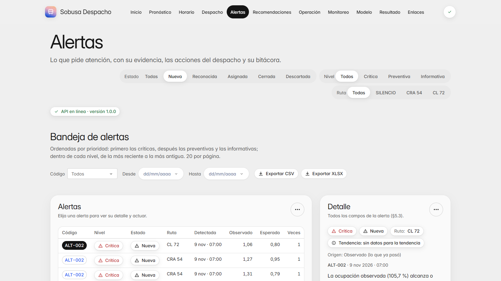

- **Bandeja.** Muestra las alertas de `GET /api/v1/alerts`, de la más reciente a la más antigua y 20 por página. Se
  filtran por estado, nivel, ruta, código y fechas. El nivel y el estado aparecen como chips con icono y palabra, para
  que no dependan solo del color.
- **Detalle.** Clic en una fila. Muestra todos los campos de §5.3, agrupados:
  - identificación y contexto: origen (pronóstico, observado, calidad de datos o modelo), empresa, ruta, sentido,
    viaje, conductor (solo su seudónimo) y vehículo. En ALT-006 (despacho ausente o tardío), el viaje, el vehículo y el
    conductor son los del despacho cancelado, tardío o sin finalizar de la ventana; en ALT-009 (datos incompletos), los
    del viaje con datos faltantes. Salen de los viajes programados (`progvehiculos`) cuando la fuente los trae. En una
    ALT-002 observada medida en el segmento crítico (con la base operacional), el sentido (aproximado), el viaje, el
    vehículo y el conductor son los del viaje más cargado en ese segmento, y sus variables dicen el segmento y el método
    (`metodo_ocupacion`). Las demás reglas son de la ruta y no tienen un viaje. Cuando un campo está vacío y la
    regla no mira un viaje, el detalle muestra «— no aplica en el nivel ruta-hora». Si la regla sí lo mira (ALT-006,
    ALT-009 y la ALT-002 del segmento crítico) y no se pudo identificar, muestra «— sin identificar» con el motivo; por
    ejemplo, que la fuente de datos no expone los viajes. El detalle está en la variable `identificacion_5_3` (grupo
    «Variables»): qué campos aplican a esa regla, por qué y qué se encontró (por ejemplo, `fuente_sin_viajes`);
  - tiempo: detección, ventana y horizonte;
  - evidencia: observado, esperado, umbral, puntaje y probabilidad con su método (nunca una cifra opaca, §9.4), y la
    tendencia (al alza, a la baja o estable) con su pendiente, como chip con icono y palabra. En ALT-003 (frecuencia
    insuficiente), la probabilidad es la de que la carga del tramo más cargado supere la capacidad efectiva de la
    frecuencia de hoy; la alerta sale solo si llega al mínimo gobernado (`alt003_probabilidad_minima`);
  - serie reciente: un gráfico pequeño con lo real frente a lo esperado de las horas analizadas; su tabla está en el «…»;
  - lectura: explicación en lenguaje operativo, variables influyentes del modelo (SHAP) ordenadas por su efecto en
    pasajeros y recomendación;
  - ubicación: coordenadas y enlace al mapa (OpenStreetMap) cuando la fuente trae el lugar; si no, el detalle lo dice
    («la fuente no trae coordenadas»), como pasa con la fuente Parquet;
  - gestión: asignación, comentarios y bitácora completa (`/history`).

  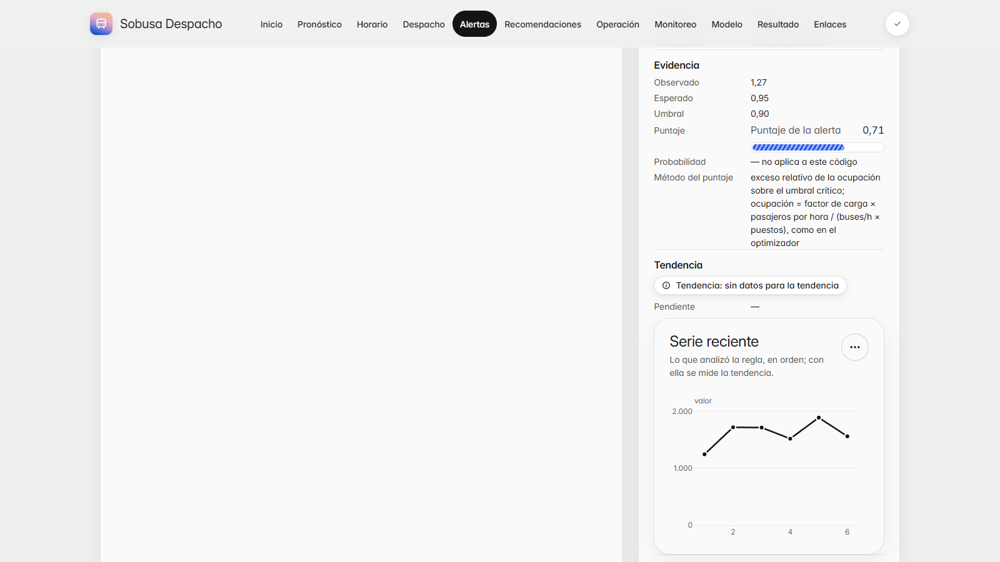
- **Por lugar (solo en la API).** `GET /api/v1/alerts?cerca_de=<lat>,<lon>&radio_m=<metros>` devuelve las alertas a esa
  distancia o menos (radio por omisión 1.000 m, máximo 50 km); la exportación acepta el mismo filtro (sección 7).
- **Acciones.** Solo se activan las que permite el estado actual (sección 4).
- **Exportar.** CSV y XLSX con los mismos filtros (`GET /api/v1/alerts/export`).

### 3.3 Recomendaciones · ¿Cada cuánto debe salir un bus?

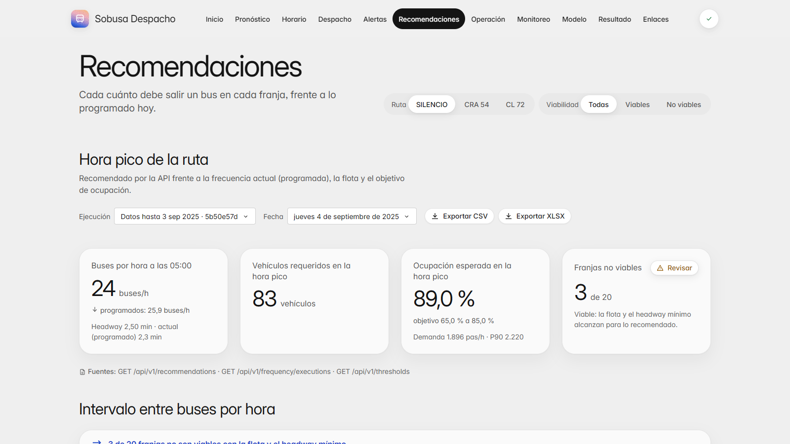

- **Controles.** Ruta, viabilidad, ejecución y fecha. Los datos salen de `GET /api/v1/recommendations` y
  `GET /api/v1/frequency/executions`.
- **Cifras de la hora pico.** Compara:
  - los buses por hora recomendados con los programados;
  - los vehículos requeridos con la flota disponible;
  - la ocupación esperada con el rango objetivo de los umbrales vigentes.
- **Gráfico.** El headway recomendado frente a la **frecuencia actual (programada)**, hora por hora.
- **Tabla por franja.** Demanda, P90, buses por hora, headways, diferencia, vehículos, ocupación, si es viable y el
  motivo con la fórmula. Las franjas no viables aparecen señaladas con su motivo
  (`evidencias/tablero/dash_recomendaciones_no_viable.png`); el plan del día por hora, en
  `evidencias/tablero/dash_recomendaciones_plan.png`.
- **Cómo leer el plan del día (`GET /api/v1/recommendations/plan`).** Una hora con una sola salida trae
  `sin_intervalo = true`: no hay intervalo entre salidas que revisar, así que esa hora no sale «no viable» por el
  headway mínimo. El plan da dos cifras de vehículos, explicadas en `definicion_vehiculos`:
  - `vehiculos_hora_pico`, la de §10.3 (⌈ciclo / headway⌉ en la hora más exigente), que puede pasar la flota;
  - `buses_en_ruta_pico`, los buses en la calle a la vez con el plan, que es la que se compara con la flota disponible.

  En el ejemplo de CRA 54 del 19-11-2025 son 106 y 78,55, con 79 buses disponibles
  (`evidencias/optimizacion/ejemplo_plan_d5.json`).
- **Ocupación por segmento en el plan (§10.1; por ahora solo en la API, el tablero no la muestra).** El ejemplo
  guardado es anterior y no trae estos campos:
  - `ocupacion_historica` en cada hora: el segmento crítico histórico de esa hora y ese día de la semana (el tramo
    donde el bus suele ir más lleno), con su sentido aproximado, su carga a bordo y su ocupación. Sale de los viajes
    de ene.–feb. 2023 y sirve para saber dónde se llena el bus; no cambia el número de salidas.
  - `ocupacion_actual` en el día: si la restricción reactiva aplicó y en qué hora, o por qué no (vacía si el plan se
    calculó sin ocupación medida). Con la base operacional, el sistema mide la ocupación real de cada segmento con las
    subidas y bajadas de cada viaje; si el segmento crítico de la última hora cerrada llegó a la ocupación crítica
    (90 % con los umbrales vigentes), la siguiente hora que todavía se puede programar no baja de las salidas que pide
    esa carga. La hora en que actúa trae `restriccion_reactiva` con el piso y la fórmula.
  - La restricción reactiva solo actúa en una ejecución pedida dentro del día, con un `instante` del día en curso (rol
    analista; sección 7). En la ejecución programada de la madrugada no actúa: el plan es del día siguiente y, con la
    base operacional, `ocupacion_actual` dice por qué no aplicó.
- **«Calcular escenario».** Llama a `POST /api/v1/recommendations/calculate` (rol analista) con la demanda, la capacidad
  y, si quiere cambiarlos, el nivel de servicio y los pesos α, β, γ y δ. Pone el resultado al lado de la recomendación
  vigente, con todo lo que explica la API:
  - la función objetivo de §10.2 término por término (α·costo operativo + β·tiempo de espera + γ·sobreocupación +
    δ·desviación de la frecuencia): componente, peso, valor ponderado y de dónde salió cada peso (código,
    `threshold_config` o la solicitud);
  - las restricciones con su valor, su límite y su holgura, y los límites que mandan (capacidad del nivel de servicio,
    flota, headway mínimo o máximo);
  - la mezcla de tipologías de bus (§10.1);
  - la frecuencia programada frente a la recomendada (RF-008);
  - si no es viable, el motivo con sus cifras y la mejor aproximación ejecutable (§18).

  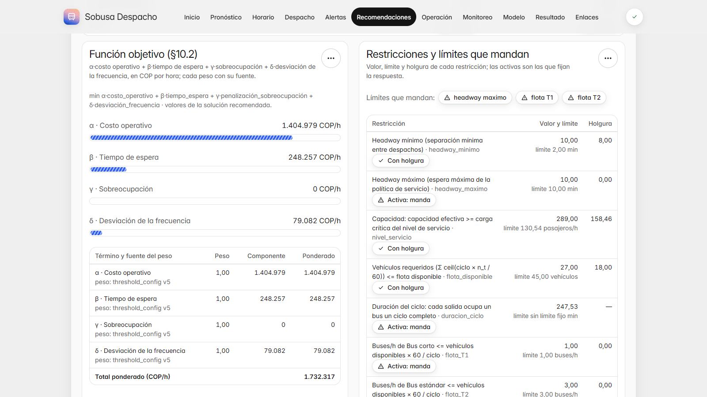
- **Plan del día por hora.** Para una ruta y una fecha, el plan del optimizador D5 con el pronóstico del modelo
  activo (`GET /api/v1/recommendations/plan`): fichas del día, un gráfico con lo programado (escalón gris) frente al
  plan (barras) y la tabla con los despachos de cada hora (`evidencias/tablero/dash_recomendaciones_plan.png`). Cada
  hora dice qué límite manda (flota, headway mínimo o máximo), si es viable y por qué. El plan lo calcula la ejecución
  diaria para el día siguiente; si todavía no está calculado para esa fecha, la API responde 404 `sin_calcular`, y un
  analista lo pide con `POST /api/v1/respuesta/calcular`.
- **El headway máximo.** Es el menor entre `headway_maximo_min` y el doble de la espera máxima (`espera_max_min`),
  porque la espera media de un pasajero es la mitad del intervalo entre buses. Con los valores vigentes (10 y 5 min)
  son 10 min. Si la operación decide que la espera máxima es el intervalo entre despachos, basta con una versión nueva
  de umbrales (sección 3.3).
- **Exportar.** CSV y XLSX.

### 3.4 Operación · ¿Cómo está corriendo el sistema?

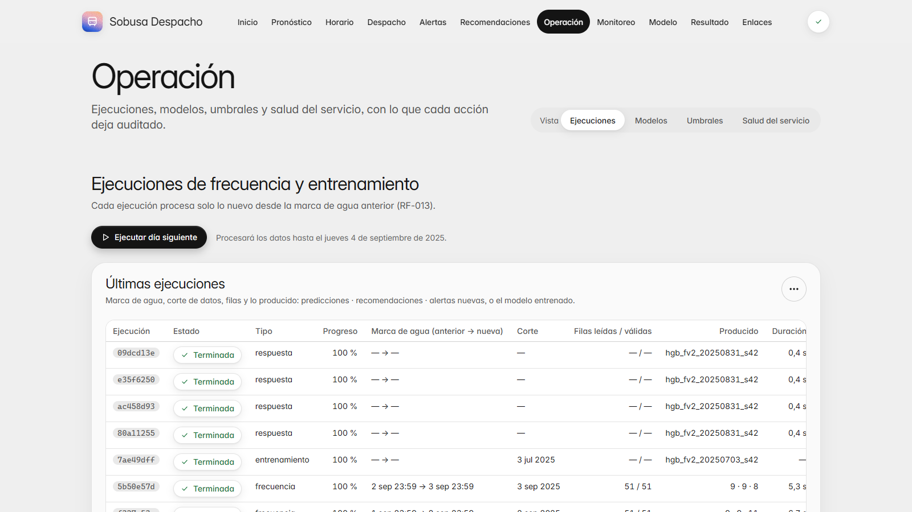

Tiene cuatro vistas (Ejecuciones, Modelos, Umbrales y Salud del servicio). Las capturas `*_1366x768.png` de esta sección
son de la versión anterior del tablero, con diez pestañas y la cuarta vista todavía llamada «Monitoreo»; el contenido de
cada vista es el mismo.

- **Ejecuciones.**
  - Para cada ejecución: la marca de agua anterior y la nueva (solo se leyó lo nuevo), el corte de datos, las filas
    leídas y válidas, lo producido y la duración.
  - El detalle trae el WAPE, la cobertura P10–P90 y los errores de calidad, filtrables por lote, dimensión y código.
    Cada error dice qué registro lo tuvo (la llave: ruta, fecha y hora), el valor que llegó, la causa y si bloqueó la
    fila (las filas bloqueadas no entran al histórico; los errores de oportunidad solo informan). Un ejemplo con un
    error de cada regla está en `evidencias/datos/errores_lote.txt`.
  - Con la base operacional, los errores traen también las diferencias entre los consolidados de Extreme y lo que el
    sistema calculó con sus propios datos (códigos CONTR-001 a CONTR-003, en el lote
    `<8 caracteres del execution_id>:<tabla>`). No se corrige nada: una diferencia «bloqueante» deja esa llave del
    consolidado fuera del análisis, y la pregunta queda para el responsable del consolidado (H17 de
    `hallazgos_extreme.md`). El resumen de cada tabla está en `metricas.calidad.consolidados` de la ejecución
    (`GET /api/v1/frequency/executions/{execution_id}`).
  - «Ejecutar día siguiente» lanza el job (rol analista) y el tablero sigue su progreso cada 2 segundos.
- **Modelos.** 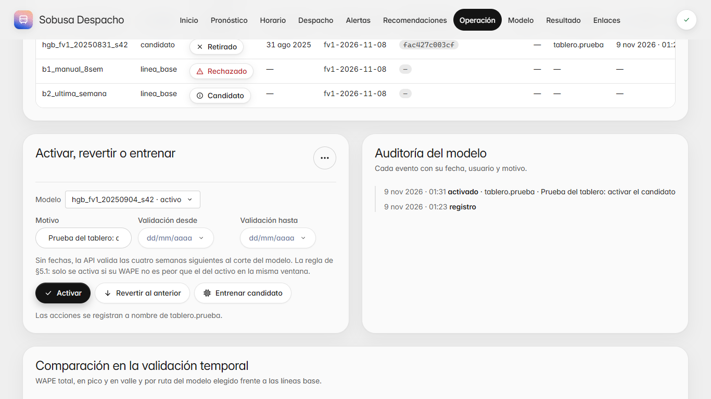
  - El registro: estado, corte, variables, SHA-256, WAPE de validación, quién lo aprobó y cuál era el anterior.
  - La comparación con las líneas base y la auditoría en una línea de tiempo.
  - Las acciones activar y revertir (rol admin) y entrenar candidato (rol analista). Si la activación se rechaza
    (409), el tablero muestra el motivo.
- **Umbrales.** La versión vigente y el historial de cada umbral. Una versión nueva se crea con su motivo (rol
  admin) y queda como propuesta hasta que el área operativa la aprueba (`POST /api/v1/thresholds/{version}/aprobar`,
  rol admin), que registra quién y cuándo. `GET /api/v1/thresholds` dice si la versión vigente está aprobada.
  Entre los umbrales están la tarifa, la elasticidad y la suavidad del plan del día, los seis parámetros de la
  retención de datos (`retencion_*`; ver «Retención de datos», abajo), las tolerancias con que se comparan los
  consolidados de Extreme (`contraste_tolerancia`, `contraste_tolerancia_grosera` y `contraste_viajes_minimos`) y el
  mínimo de probabilidad de ALT-003 (`alt003_probabilidad_minima`). La versión que siembra ese mínimo (0,30) queda como
  propuesta hasta que el área operativa la apruebe. Un valor fuera de rango no se guarda: la API responde 422. Un
  cambio rige desde el cálculo siguiente, sin reiniciar, y el plan dice con qué versión y con qué fuente se calculó cada
  parámetro (`parametros` de `GET /api/v1/recommendations/plan`). La flota disponible y el tiempo de ciclo de cada ruta
  se ajustan solo por la API (`PUT /api/v1/catalogos/flota`, rol admin; sección 7), con el mismo versionado.
  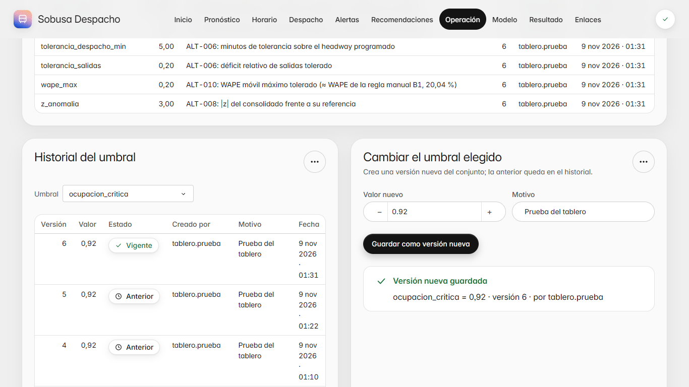
- **Salud del servicio.** `/health`, las métricas (peticiones, errores y p95 aproximado por ruta), las alertas nuevas
  por nivel y el WAPE frente a su tolerancia. El monitoreo del modelo (deriva, error móvil, reentrenamiento y retador en
  sombra) tiene su propia pantalla, Monitoreo (sección 3.4), y esta vista enlaza a ella.
  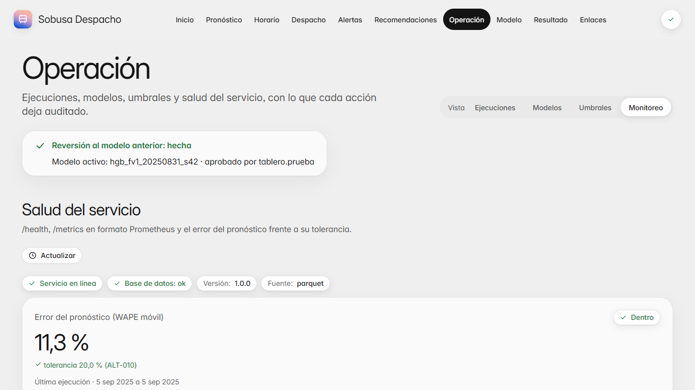
- **Retención de datos (§18; solo en la API, el tablero no la muestra).** Por omisión, el sistema guarda 13 meses de
  resultados y borra lo anterior, solo en su propio esquema: las fotos de variables por mes, las predicciones y
  recomendaciones, las alertas cerradas o descartadas, las notificaciones y las ejecuciones que ya no sostienen nada.
  Nunca borra una alerta abierta, el histórico validado ni la ocupación por segmento.
  - `GET /api/v1/retencion` (cualquier rol) dice qué hace con cada tabla, el corte de hoy y lo que hizo la última
    corrida.
  - Con el planificador encendido (como en Docker), la corrida programada de los domingos a las 03:30 borra de
    verdad. Un administrador puede dejarla solo en simulación con una versión nueva de umbrales con
    `retencion_aplicar_programada` = 0, o correrla cuando quiera con `POST /api/v1/retencion/aplicar`, que por
    omisión solo simula (sección 7).

Con una clave de operador, las acciones de analista o de administrador quedan bloqueadas y el tablero dice qué rol
hace falta (`evidencias/tablero/operacion_403_operador_1366x768.png`).

### 3.5 Monitoreo · ¿El modelo sigue sirviendo?

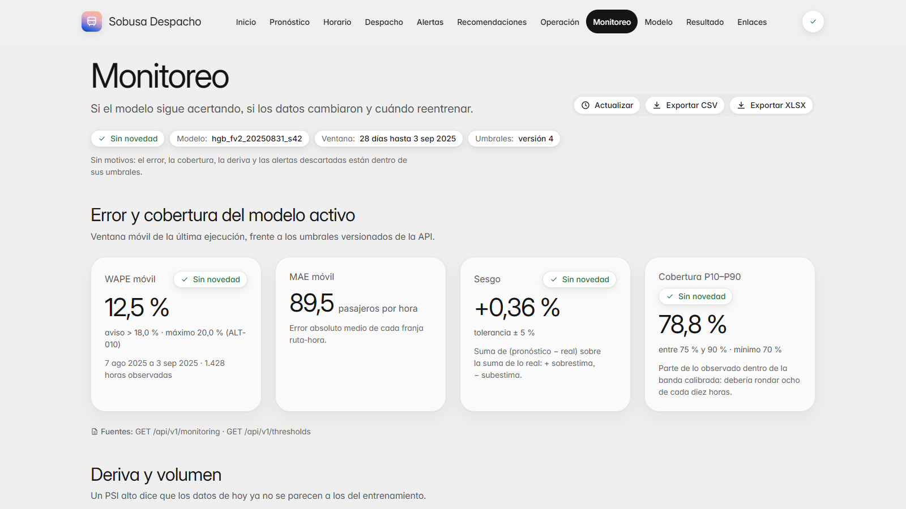

Lee `GET /api/v1/monitoring?familia=horario`, `GET /api/v1/monitoring/policy`, `GET /api/v1/models` y los umbrales
vigentes. Es el monitoreo del modelo horario; el del corto plazo está en la tarjeta «El modelo» de Pronóstico (sección
3.1).

| Sección o tarjeta | Qué responde |
|---|---|
| Error y cobertura del modelo activo | ¿El modelo sigue acertando? Estado general con sus motivos; WAPE, MAE y sesgo de la ventana móvil y cobertura P10–P90, cada uno frente a su umbral versionado. |
| Deriva de los datos (PSI por variable) | ¿Los datos de hoy se parecen a los del entrenamiento? El PSI de cada variable con su umbral de aviso y de alerta. |
| Volumen y alertas descartadas | ¿Cuántas predicciones se hicieron y qué parte de las alertas se descartó (posibles falsos positivos)? |
| ¿Hay que reentrenar? | La decisión de la política con cada disparador (periodicidad, degradación, deriva y cobertura), sus motivos y sus bloqueos. |
| Retador en sombra y su compuerta | Si hay un candidato prediciendo en paralelo y cómo va en los cuatro criterios de la compuerta. |
| Últimas filas de monitoreo | Una fila por ejecución: error móvil, cobertura, sesgo, deriva máxima y estado. Se exportan en CSV y XLSX (`GET /api/v1/monitoring/export`; ejemplo en `evidencias/tablero/export_monitoreo_dash.csv`). |

Los estados siempre van con icono y palabra («Sin novedad», «Aviso», «Alerta»), no solo con color.
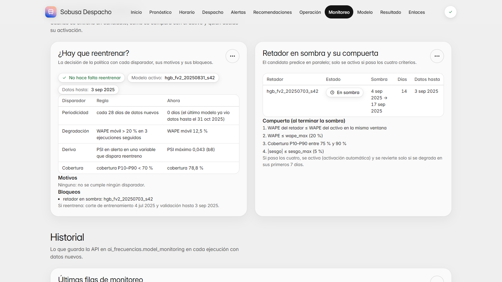

### 3.6 Las pantallas del laboratorio del modelo

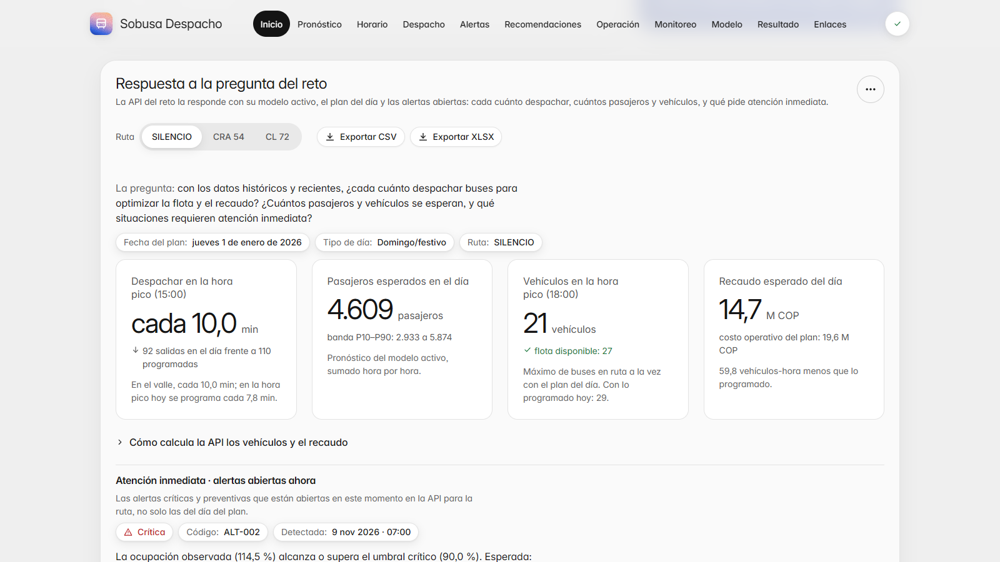

| Pantalla | Pregunta que responde | Qué mirar |
|---|---|---|
| Inicio | ¿Qué proponemos? | La propuesta en una frase, el ahorro en operación con lo que se juega en pasajes contado en tres pasos (primero el piloto que lo mide; si las salidas nuevas atraen suficientes pasajeros, el plan se aplica; si atraen menos, no se aplica), el error de la regla manual frente al modelo y el servicio (pasajeros sobre la capacidad y espera). La tarjeta «Respuesta a la pregunta del reto» trae, desde la API, cada cuánto despachar, cuántos pasajeros y vehículos se esperan y qué alertas piden atención, por ruta. |
| Pronóstico | ¿Cuántos pasajeros habrá? | Arriba, «Lo que pide el enunciado» (sección 3.1). Después, «Modelo horario de la API: el plan del día siguiente»: los pronósticos horarios que guarda la API con su modelo (`GET /api/v1/predictions?modelo=horario`), con la banda P10–P90 calibrada frente a lo real, las variables que más mueven cada pronóstico (SHAP) y la exportación. Debajo, los experimentos del informe: pasajeros reales frente a pronosticados hora por hora para una ruta y un día de 2025, con la banda de la hora pico y la regla manual, hechos con 7 días de antelación. |
| Horario | ¿Cuántos buses y cada cuánto? | El optimizador D5 resuelto en el momento con los costos, la elasticidad y el intervalo que usted elija: salidas por hora frente a las de hoy, carga del punto más lleno, balance del día y horario minuto a minuto (CSV). |
| Despacho | ¿Qué sale ahora y en qué bus? | Un día de 2025 repetido como si fuera en vivo: reloj, fichas (salidas frente al plan, buses en la calle, próximo despacho), mapa con los buses, alertas y próximos despachos. Es una repetición sin mandos: no controla ningún bus (§3.2). |
| El modelo | ¿Qué modelo es y por qué? | El error de los modelos del informe académico (experimentos 1, 11 y 12, a 7 días y sobre todo 2025) frente a la regla manual, su ficha y las variables que más pesan. No son los modelos que corren en la API: esos son `hgb_fv2_20250831_s42` (horario, con su error en `evidencias/modelo/evaluacion_modelo.md`) y `cp_lgbm_20250630_s42` (corto plazo, tarjeta «El modelo» de Pronóstico). |
| Resultado | ¿Qué gana Sobusa? | Dónde se quitan y se ponen salidas, la cascada del ahorro al saldo, la comparación entre reasignar y recortar, y la sensibilidad a la elasticidad. |
| Anexos | ¿Qué más hay, aparte de este tablero? | El material de apoyo: el informe técnico, el cuaderno, la app sin conexión y los documentos del proyecto. No hace falta abrirlo para entender la propuesta. |

El detalle de cada tarjeta está en `../../dash_app/README.md`.

### 3.7 Rutina sugerida por turno

| Momento | Quién | Qué hacer en el tablero |
|---|---|---|
| Al empezar el turno | Despachador | En Inicio, leer la tarjeta «Respuesta a la pregunta del reto» de su ruta: headway por franja, pasajeros esperados, vehículos y alertas abiertas. En Alertas, filtrar `estado = nueva` y `nivel = crítica`. |
| Durante el turno | Despachador | Reconocer cada alerta crítica en cuanto la vea, asignarla a quien la atiende y comentar lo que se hizo. Antes de un refuerzo, revisar en Recomendaciones la franja y su viabilidad. |
| Cada hora pico | Supervisor de turno | Revisar las franjas no viables y decidir el refuerzo o el cambio de tipología. Dejar en el comentario de la alerta por qué se siguió o no la recomendación. |
| Una vez al día | Analista | En Operación, confirmar que la ejecución diaria terminó en `ok` y revisar los errores de calidad. En Monitoreo, mirar el estado del modelo horario y si la política pide reentrenar; en Pronóstico, la tarjeta «El modelo» para el de corto plazo. |
| Una vez a la semana | Analista y supervisor | Revisar las alertas descartadas (posibles falsos positivos) y proponer, con su motivo, una versión nueva de umbrales si hace falta. |

## 4. Cómo gestionar una alerta

```
 nueva ──reconocer──► reconocida ──asignar──► asignada ──cerrar──► cerrada
   │                      │                      │  ▲
   └──────descartar───────┴──────descartar───────┘  └─ asignar (reasignar)
                                ▼
                            descartada            «comentar» agrega una nota sin cambiar el estado
```

1. **Reconocer**: «la vi y me hago cargo». Pase de `nueva` a `reconocida`.
2. **Asignar** a una persona (campo `asignado_a`, obligatorio). Si falta, la API responde 422 y el tablero lo muestra.
3. **Comentar** lo que se hizo (por ejemplo, «se envía un bus de refuerzo»).
4. **Cerrar** cuando quedó resuelta, o **descartar** si no procede (desde `nueva`, `reconocida` o `asignada`). Las
   descartadas cuentan en el monitoreo como posibles falsos positivos (§9.4).

Una transición que no existe, como cerrar una alerta nueva, responde 409 `transicion_invalida` y no cambia nada
(`evidencias/tablero/alertas_409_1366x768.png`). Cada acción queda en la bitácora con usuario, fecha y comentario.

**Si la misma situación sigue**, no aparece una alerta nueva: se actualiza la misma, suben sus ocurrencias y la
bitácora anota «redetección». Así la bandeja no se llena de repetidas (§18 «Alertas excesivas»).

**Si la situación empeora**, la misma alerta sube de severidad (por ejemplo, de preventiva a crítica) sin cambiar de
estado, y la bitácora anota «escalar» con la severidad anterior y la nueva. Si queda crítica, se notifica. La severidad
nunca baja sola: si la situación mejora, la alerta conserva su severidad y solo suma la ocurrencia; quien la atiende la
cierra.

## 5. Cómo leer una recomendación

Ejemplo real de la API, guardado en `evidencias/optimizacion/ejemplo_calculate.json`. Para CRA 54 a las 7 h, con 1.000
pasajeros por hora esperados (P90 = 1.180), la respuesta trae:

- `buses_hora = 12` y `headway_min = 5,00`: un despacho cada 5 minutos;
- `vehiculos_requeridos = 51` para un ciclo de 249,1 minutos;
- `ocupacion_esperada = 0,678` (67,8 %), dentro del rango objetivo de 65 % a 85 % de §5.1;
- `frecuencia_actual_min = 2,94`, la frecuencia programada hoy, para comparar;
- `explicacion`: las frases que dicen qué límite manda (capacidad del nivel de servicio, flota, headway mínimo o
  máximo) y por qué se eligió ese número de buses y no uno más o uno menos;
- `objetivo`: la función objetivo de §10.2 con cada peso (α, β, γ y δ), su valor y su fuente (por ejemplo,
  `threshold_config` y su versión, o la solicitud);
- `restricciones` y `limites_activos`: cada restricción con su valor, su límite y su holgura, y cuáles mandan (en el
  ejemplo, el nivel de servicio y la flota de dos tipologías);
- `tipologias`: cuántos buses de cada tipología usa la recomendación frente a los disponibles (§10.1);
- `linea_base_10_3`: la cuenta simple de §10.3, para contrastar;
- `comparacion_actual`: costo, espera, sobreocupación esperada y vehículos de la frecuencia programada frente a los de
  la recomendada;
- `ocupacion_historica` (el ejemplo guardado es anterior y no lo trae): el segmento crítico histórico de la franja, el
  tramo donde el bus suele ir más lleno a esa hora y ese día de la semana, con su sentido aproximado, su carga a bordo
  y su ocupación con los puestos de la recomendación. También va como una frase al final de la `explicacion`.

**Viabilidad.** Si la flota o el headway mínimo no alcanzan para la demanda, la recomendación sale `viable = false` con
un `motivo` en cifras, en lugar de forzar un número. En `evidencias/optimizacion/ejemplo_calculate_no_viable.json`,
6.000 pasajeros por hora en CRA 54 exigirían 4.065 puestos por hora y el máximo posible es 2.160; la flota disponible
(79 vehículos) no lo sostiene. La respuesta trae además la mejor aproximación ejecutable, que respeta la flota y el
headway mínimo y dice qué parte de la demanda cubre. Es una respuesta válida: le dice al supervisor que hace falta
refuerzo o un cambio de tipología.

## 6. Monitoreo del modelo

`GET /api/v1/monitoring` (y la pantalla Monitoreo del tablero, sección 3.4) da, por ejecución:

- el WAPE, el MAE y el sesgo móviles de 28 días;
- la cobertura de la banda P10–P90;
- la deriva de cada variable (PSI);
- el volumen de predicciones y el porcentaje de alertas descartadas.

El estado puede ser `ok`, `aviso` o `alerta`. `GET /api/v1/monitoring/policy` dice si toca reentrenar y por qué, y si
hay un candidato en sombra. Si el error móvil de una ruta pasa la tolerancia, aparece la alerta ALT-010 «Modelo
degradado». Activar o revertir un modelo es una decisión del administrador (sección 3.3).

Hay dos modelos, y cada fila de monitoreo es de uno: `GET /api/v1/monitoring?familia=horario` (el del plan del día
siguiente, lo de arriba) o `?familia=corto_plazo`. El del corto plazo lo deja cada ciclo diario con los últimos 7 días
completos leídos: WAPE, MAE y sesgo móviles por horizonte y por ruta, cobertura P10–P90, pronósticos guardados y PSI de
las variables de lo observado frente a las 4 semanas anteriores a la fecha de corte del modelo; si el WAPE móvil de una
ruta supera `wape_max`, abre ALT-010 para esa ruta. El corto plazo no tiene sombra: una versión nueva se activa con la
compuerta (sección 7).

## 7. Usar la API directamente (curl)

Cada petición a `/api/v1` lleva la cabecera `X-API-Key`. Swagger (http://localhost:8000/docs, solo en ambientes local,
pruebas o demo) permite probar cada endpoint con el botón «Authorize». Los ejemplos son para `cmd` de Windows; en
PowerShell use `curl.exe` y `` ` `` para continuar la línea, y en bash, `\`.

```
set CLAVE=<su clave>

rem La pregunta del reto respondida para una ruta (rol operador); sin fecha, el día siguiente al último dato.
rem Lee la foto que guardó el ciclo; si no la hay, responde 404 sin_calcular
curl -H "X-API-Key: %CLAVE%" "http://localhost:8000/api/v1/respuesta?ruta=CRA%2054"
rem Pedir el cálculo de una fecha (rol analista): responde 202 con execution_id y dónde consultar el estado
curl -X POST http://localhost:8000/api/v1/respuesta/calcular -H "X-API-Key: %CLAVE%" ^
     -H "Content-Type: application/json" -d "{\"fecha\": \"2025-11-19\"}"
rem La misma respuesta, una fila por ruta y hora, en CSV (sin foto, 404 sin_calcular)
curl -H "X-API-Key: %CLAVE%" -o respuesta.csv "http://localhost:8000/api/v1/respuesta/export?formato=csv&ruta=CRA%2054"

rem Lanzar una ejecución con los datos hasta una fecha (rol analista); responde 202 con execution_id
curl -X POST http://localhost:8000/api/v1/frequency/executions -H "X-API-Key: %CLAVE%" ^
     -H "Content-Type: application/json" -d "{\"hasta\": \"2025-09-30\"}"
curl -H "X-API-Key: %CLAVE%" http://localhost:8000/api/v1/frequency/executions/<execution_id>
curl -H "X-API-Key: %CLAVE%" http://localhost:8000/api/v1/frequency/executions/<execution_id>/errors
rem Las diferencias con el consolidado de Extreme por ruta de esa ejecución (con la base operacional)
curl -H "X-API-Key: %CLAVE%" "http://localhost:8000/api/v1/frequency/executions/<execution_id>/errors?codigo=CONTR-001"
rem El día siguiente, partido en un trabajo por ruta (la respuesta trae «trabajos»), y la marca de agua de cada ruta
curl -X POST http://localhost:8000/api/v1/frequency/executions -H "X-API-Key: %CLAVE%" ^
     -H "Content-Type: application/json" -d "{\"hasta\": \"2025-10-01\", \"particion\": \"ruta\"}"
curl -H "X-API-Key: %CLAVE%" http://localhost:8000/api/v1/frequency/watermarks
rem Ejecución dentro del día (rol analista): con un «instante» del día en curso, el plan es de ese día y, con la base
rem operacional, la restricción reactiva de la ocupación por segmento puede actuar en la hora siguiente
curl -X POST http://localhost:8000/api/v1/frequency/executions -H "X-API-Key: %CLAVE%" ^
     -H "Content-Type: application/json" -d "{\"instante\": \"<AAAA-MM-DD>T09:05:00-05:00\"}"

rem Flota disponible y tiempo de ciclo vigentes de una ruta (rol operador), un ajuste de flota (rol admin) y su historial
curl -H "X-API-Key: %CLAVE%" "http://localhost:8000/api/v1/catalogos/flota?idruta=16&tipo_dia=Laboral"
curl -X PUT http://localhost:8000/api/v1/catalogos/flota -H "X-API-Key: %CLAVE%" ^
     -H "Content-Type: application/json" ^
     -d "{\"idruta\": 16, \"tipo_dia\": \"Laboral\", \"flota\": 40, \"motivo\": \"Flota informada por la operación\"}"
curl -H "X-API-Key: %CLAVE%" "http://localhost:8000/api/v1/catalogos/flota/historial?idruta=16"

rem Pedir el refresco de las estadísticas por segmento (rol analista; necesita la base operacional)
curl -X POST http://localhost:8000/api/v1/segmentos/estadisticas/refrescar -H "X-API-Key: %CLAVE%" ^
     -H "Content-Type: application/json" -d "{\"modo\": \"auto\"}"

rem Política de retención y su última corrida (rol operador), y una corrida bajo demanda (rol admin): por omisión
rem solo simula; con "simular": false borra lo anterior al corte. Responde 202 con el execution_id
curl -H "X-API-Key: %CLAVE%" http://localhost:8000/api/v1/retencion
curl -X POST http://localhost:8000/api/v1/retencion/aplicar -H "X-API-Key: %CLAVE%" ^
     -H "Content-Type: application/json" -d "{\"simular\": true, \"motivo\": \"Revisión antes de aplicar\"}"

rem Lo que pide el enunciado: las subidas de los próximos 60 minutos por ruta, sentido y segmento (rol analista; se
rem guarda). Por omisión («modelo»: «auto») responde el pronóstico de corto plazo si cubre la ruta, la fecha y la hora
rem (medias horas de 04:00 a 21:00, con datos leídos hasta el instante); si no, el horario. «modelo» y «motivo_modelo»
rem dicen cuál respondió y por qué. Con «modelo»: «corto_plazo» queda fijado: fuera de cobertura, 422 fuera_de_cobertura
curl -X POST http://localhost:8000/api/v1/predictions/run -H "X-API-Key: %CLAVE%" ^
     -H "Content-Type: application/json" ^
     -d "{\"ruta\": \"CRA 54\", \"instante\": \"2025-10-15T07:00:00-05:00\", \"horizonte_min\": 60, \"modelo\": \"corto_plazo\"}"
rem El mismo pedido con el modelo horario (el del plan del día siguiente, con siete días de antelación)
curl -X POST http://localhost:8000/api/v1/predictions/run -H "X-API-Key: %CLAVE%" ^
     -H "Content-Type: application/json" ^
     -d "{\"ruta\": \"CRA 54\", \"instante\": \"2025-10-15T07:00:00-05:00\", \"horizonte_min\": 60, \"modelo\": \"horario\"}"
rem Para no recibir cada segmento (los sentidos van siempre), agregue al cuerpo "incluir_segmentos": false
rem El endpoint propio del corto plazo, que también guarda; sin guardar, con rol operador:
rem GET /api/v1/predictions/corto-plazo/calcular?ruta=...&instante=...&horizonte_min=60
curl -X POST http://localhost:8000/api/v1/predictions/corto-plazo -H "X-API-Key: %CLAVE%" ^
     -H "Content-Type: application/json" ^
     -d "{\"ruta\": \"CRA 54\", \"instante\": \"2025-10-15T07:00:00-05:00\", \"horizonte_min\": 60}"

rem Los pronósticos guardados de cada modelo (rol operador); sin «modelo», los dos mezclados
curl -H "X-API-Key: %CLAVE%" "http://localhost:8000/api/v1/predictions?modelo=corto_plazo&ruta=CRA%2054&limite=5"
curl -H "X-API-Key: %CLAVE%" "http://localhost:8000/api/v1/predictions?modelo=horario&ruta=CRA%2054&limite=5"
rem Las recomendaciones hechas con el pronóstico de corto plazo
curl -H "X-API-Key: %CLAVE%" "http://localhost:8000/api/v1/recommendations?origen=corto_plazo&ruta=CRA%2054"
rem Las próximas dos horas de una ruta («proximas_dos_horas» de la respuesta del reto: 30, 60 y 120 min con su
rem recomendación y los 5 segmentos más cargados), en un instante; sin «instante», el último día con datos leídos a la
rem hora actual. Necesita la foto de la respuesta, como el resto de esa consulta (si no la hay, 404 sin_calcular)
curl -H "X-API-Key: %CLAVE%" "http://localhost:8000/api/v1/respuesta?ruta=CRA%2054&instante=2025-10-15T07:00:00-05:00"

rem Recomendación para una franja (rol analista) y plan del día (rol operador)
curl -X POST http://localhost:8000/api/v1/recommendations/calculate -H "X-API-Key: %CLAVE%" ^
     -H "Content-Type: application/json" -d "{\"ruta\": \"CRA 54\", \"hora\": 7, \"demanda_hora\": 1000, \"demanda_p90\": 1180}"
curl -H "X-API-Key: %CLAVE%" "http://localhost:8000/api/v1/recommendations/plan?ruta=CRA%2054&fecha=2025-03-04"

rem Alertas nuevas y críticas de una ruta, alertas a 500 m de un punto, y gestión de una alerta (rol operador)
curl -H "X-API-Key: %CLAVE%" "http://localhost:8000/api/v1/alerts?estado=nueva&severidad=critica&ruta=CL%2072"
curl -H "X-API-Key: %CLAVE%" "http://localhost:8000/api/v1/alerts?cerca_de=10.981,-74.801&radio_m=500"
rem Despachos ausentes o tardíos (ALT-006) de una ruta, con el viaje, el vehículo y el seudónimo del conductor
curl -H "X-API-Key: %CLAVE%" "http://localhost:8000/api/v1/alerts?codigo=ALT-006&ruta=CRA%2054"
curl -X PATCH http://localhost:8000/api/v1/alerts/<alert_id>/status -H "X-API-Key: %CLAVE%" ^
     -H "Content-Type: application/json" -d "{\"accion\": \"reconocer\", \"comentario\": \"Se envía un bus de refuerzo\"}"
curl -H "X-API-Key: %CLAVE%" http://localhost:8000/api/v1/alerts/<alert_id>/history

rem Registro de modelos, entrenamiento de un candidato horario (analista), activación y reversión (admin).
rem Cada familia (horario y corto_plazo) tiene a lo sumo un activo
curl -H "X-API-Key: %CLAVE%" http://localhost:8000/api/v1/models
curl -H "X-API-Key: %CLAVE%" "http://localhost:8000/api/v1/models?familia=corto_plazo"
curl -H "X-API-Key: %CLAVE%" http://localhost:8000/api/v1/models/cp_lgbm_20250630_s42/importance
curl -H "X-API-Key: %CLAVE%" "http://localhost:8000/api/v1/monitoring?familia=corto_plazo&limite=1"
curl -X POST http://localhost:8000/api/v1/models/train -H "X-API-Key: %CLAVE%" ^
     -H "Content-Type: application/json" -d "{\"hasta\": \"2025-09-30\", \"semilla\": 42}"
curl -X POST http://localhost:8000/api/v1/models/<model_id>/activate -H "X-API-Key: %CLAVE%" ^
     -H "Content-Type: application/json" -d "{\"validacion_desde\": \"2025-12-01\", \"validacion_hasta\": \"2025-12-14\", \"motivo\": \"Compuerta de cuatro criterios\"}"
curl -X POST "http://localhost:8000/api/v1/models/<model_id>/activate?forzar=true" -H "X-API-Key: %CLAVE%" ^
     -H "Content-Type: application/json" -d "{\"motivo\": \"Aprobado por el comité de operación\"}"
curl -X POST http://localhost:8000/api/v1/models/rollback -H "X-API-Key: %CLAVE%" ^
     -H "Content-Type: application/json" -d "{\"motivo\": \"Prueba de reversión\"}"
rem La reversión del modelo de corto plazo (sin «familia», se revierte el horario)
curl -X POST http://localhost:8000/api/v1/models/rollback -H "X-API-Key: %CLAVE%" ^
     -H "Content-Type: application/json" -d "{\"familia\": \"corto_plazo\", \"motivo\": \"Prueba de reversión\"}"
```

Qué responde la activación:

- **200**: el modelo pasó la compuerta de cuatro criterios en la ventana pedida (por omisión, los 28 días siguientes a
  lo que vio el candidato) y quedó activo; el anterior queda guardado para la reversión.
- **422 `ventana_en_muestra`**: la ventana empieza dentro de lo que el candidato ya vio (en el horario, su corte más
  los 61 días de validación; en el corto plazo, su fecha de corte); el detalle dice desde qué día se puede comparar.
- **409 `activacion_rechazada`**: algún criterio no se cumplió; el modelo queda «rechazado» con el motivo.
- **409 `requiere_forzar`**: el modelo ya fue rechazado o sigue en sombra (la compuerta de sombra decide al terminar
  sus 14 días).
- **`?forzar=true`**: activa aunque no se cumplan los criterios, solo con un `motivo` (sin él, 422
  `motivo_requerido`), y deja la decisión en la auditoría del modelo.

Un modelo de corto plazo pasa por los mismos cuatro criterios, comparado con el activo de su familia en la misma
ventana, con los datos que ya leyó la API. Una versión nueva llega como candidata: la entrena
`scripts/entrenar_corto_plazo.py` y la API la registra al arrancar.

Rutas válidas en todos los filtros: `SILENCIO`, `CRA 54` y `CL 72` (en la URL, el espacio va como `%20`). Todas las
fechas salen en hora de Bogotá (`-05:00`). Las colecciones se paginan con `limite` y `desplazamiento`, y cada respuesta
trae la cabecera `X-Correlation-Id`: si algo falla, ese valor ubica el caso en los logs.

## 8. Exportar

Todas las consultas filtradas se pueden descargar en CSV o XLSX (`?formato=csv` o `?formato=xlsx`) con los mismos
filtros de la consulta. Cada descarga trae dos cabeceras: `X-Total-Count`, cuántos registros cumplen el filtro, y
`X-Truncado`, que vale `true` si el archivo se cortó en el tope de 100.000 filas (en ese caso, afine los filtros para
bajar el resto):

| Qué | Endpoint |
|---|---|
| Respuesta a la pregunta del reto (una fila por ruta y hora) | `GET /api/v1/respuesta/export` |
| Pronósticos de corto plazo (ruta, sentido y segmento) | `GET /api/v1/predictions/corto-plazo/export` |
| Pronósticos horarios (con `modelo=corto_plazo`, la fila de la ruta de los de corto plazo) | `GET /api/v1/predictions/export` |
| Recomendaciones | `GET /api/v1/recommendations/export` |
| Alertas (con los campos de §5.3) | `GET /api/v1/alerts/export` |
| Monitoreo (`familia=horario` o `familia=corto_plazo`) | `GET /api/v1/monitoring/export` |
| Estadísticas por segmento | `GET /api/v1/segmentos/estadisticas/export` |
| Catálogos (procesos, empresas, rutas, segmentos, vehículos, viajes, despachos) | `GET /api/v1/catalogos/<catálogo>/export` |

Ejemplo: `curl -H "X-API-Key: %CLAVE%" -o alertas.xlsx "http://localhost:8000/api/v1/alerts/export?formato=xlsx&estado=nueva"`.
En el tablero, los botones CSV y XLSX de Alertas, Recomendaciones, Monitoreo y la tarjeta de la respuesta en Inicio
hacen lo mismo. Hay archivos de ejemplo en `evidencias/tablero/export_alertas_dash.xlsx`,
`evidencias/tablero/export_recomendaciones_dash.csv`, `evidencias/tablero/export_monitoreo_dash.csv` y
`evidencias/tablero/export_respuesta_dash.csv`. La exportación de alertas acepta también el filtro por lugar
(`cerca_de` y `radio_m`).

Las estadísticas por segmento salen de una agregación que la API calcula aparte, como un trabajo de la cola: la
consulta dice de cuándo es (`actualizado_en`). Mientras la agregación se calcula por primera vez, la exportación
responde 503 `agregacion_pendiente` y el refresco ya queda en la cola. Un analista puede pedir otro con
`POST /api/v1/segmentos/estadisticas/refrescar` y seguir su avance en `GET /api/v1/frequency/executions/{execution_id}`.

## 9. Preguntas frecuentes

| Pregunta o síntoma | Respuesta |
|---|---|
| La pantalla dice «La API no responde en …» | Revise que la API esté arriba (`docker compose -p sobusa_api ps` o `GET /health`) y que `SOBUSA_API_URL` apunte a ella. Las siete pantallas del laboratorio siguen funcionando sin API. |
| La API responde 401 | Falta la cabecera `X-API-Key` o la clave no es válida. Pida una clave al administrador. |
| La API responde 403 | Su rol no alcanza para esa acción. La respuesta dice el rol exigido (`rol_requerido`). |
| La API responde 409 | Hay un conflicto de estado: una transición de alerta no permitida o una activación rechazada porque el candidato no mejora al activo. El mensaje explica el motivo. |
| La API responde 400 `cuerpo_ilegible` | El cuerpo de la petición no se pudo leer (por ejemplo, un archivo que no está en UTF-8). Guarde el JSON en UTF-8 y repita. |
| La API responde 422 | Un dato de la petición no es válido (por ejemplo, un horizonte distinto de 30, 60 o 120, asignar sin persona o un radio de más de 50 km). El detalle dice qué campo. Con `tipo` = `caracter_nulo`, el valor trae el byte NUL (0x00), que no se admite. Con `codigo` = `fuera_de_rango`, una fecha u otro valor es demasiado extremo para procesarlo (por ejemplo, `hasta=9999-12-31`). |
| Una recomendación sale `viable = false` | No alcanza la flota o el headway mínimo para esa demanda. El `motivo` lo explica con cifras y viene la mejor aproximación ejecutable (sección 5). |
| La ejecución terminó con 0 filas | No llegaron datos nuevos desde la marca de agua. Es lo esperado y no se reprocesa el histórico. |
| La API responde 404 `sin_calcular` en el plan o en la respuesta del reto | El plan de esa fecha todavía no está calculado (la ejecución diaria lo calcula para el día siguiente). Un analista lo pide con `POST /api/v1/respuesta/calcular`; la tarjeta de Inicio lo pide sola y muestra «Calculando…» mientras tanto. |
| Una alerta cambió de severidad sin que nadie la tocara | La situación empeoró y el sistema la escaló: la bitácora tiene la entrada «escalar» con la severidad anterior y la nueva (sección 4). |
| La ejecución quedó en `error` | `GET /api/v1/frequency/executions/{execution_id}` dice la etapa y la causa. La marca de agua no avanzó, así que se puede relanzar. En una ejecución partida por ruta, el detalle de la madre trae el estado de cada trabajo (`trabajos`): solo la ruta que falló no movió su marca, y la ejecución siguiente la vuelve a leer. |
| La exportación de estadísticas por segmento responde 503 `agregacion_pendiente` | La agregación se está calculando por primera vez y el refresco ya está en la cola. Siga su avance en `GET /api/v1/frequency/executions/{execution_id}` y repita la descarga cuando termine (sección 8). |
| ¿Por qué el sistema recomendó esto? | Cada pronóstico trae su explicación (las variables que más pesaron) y su versión de modelo y de datos. Cada recomendación trae la fórmula, los límites que mandan y la versión de umbrales. Cada alerta trae el observado, el esperado, el umbral y la explicación. |
| ¿El sistema despacha buses solo? | No. Recomienda y alerta; el despachador decide (§3.2). |
| `POST /api/v1/predictions/run` respondió con el modelo horario | Con `modelo` = `auto` (el valor por omisión), responde el corto plazo solo si cubre la ruta, la fecha y la hora: medias horas de 04:00 a 21:00 y datos ya leídos hasta ese instante. Si no, responde el horario y `motivo_modelo` dice por qué. Para exigir el corto plazo, pida `"modelo": "corto_plazo"` (fuera de cobertura responde 422 `fuera_de_cobertura`). |
| El pronóstico de corto plazo responde 422 `fuera_de_cobertura` para un día reciente | Ese día solo está leído hasta cierta hora y el pronóstico no se adelanta a la lectura: usa solo lo ya leído. El mensaje dice hasta qué hora hay datos; la respuesta de un instante válido lo trae en `datos_hasta`. |
| En Pronóstico aparece el aviso «Datos excluidos» | La regla de calidad VAL-009 excluyó celdas imposibles de lo que usa ese pronóstico; cuentan como no observadas (sección 3.1). En la lectura de cada ejecución, esas celdas quedan además en `GET /api/v1/frequency/executions/{execution_id}/errors?codigo=VAL-009`. |
| ¿El sistema borra datos viejos? | Sí: por omisión, lo de más de 13 meses y solo en su propio esquema; nunca una alerta abierta ni el histórico validado. `GET /api/v1/retencion` dice qué borra, el corte de hoy y qué hizo la última corrida (sección 3.3, «Retención de datos»). |
| El plan dice que la restricción reactiva no aplicó | Solo actúa dentro del día, en una ejecución con un `instante` del día en curso y con la base operacional. La ejecución programada calcula el plan del día siguiente, así que ahí no aplica (sección 3.2). |
| Una ALT-006 o una ALT-009 no trae viaje ni vehículo | El viaje sale de los viajes programados (`progvehiculos`) de la base operacional, de la réplica o de su exportación. Sin ninguna de ellas, la alerta sale igual y su variable `identificacion_5_3` lo dice (`resultado` = `fuente_sin_viajes`). En una ALT-006 en la que todos los despachos salieron a tiempo, el faltante es de programación y la alerta no inventa un viaje. |
| Una ALT-009 no cuenta una hora sin datos | Si en esa hora no había ningún viaje programado sin cancelar, no faltaba ningún dato: la alerta la deja en la variable `horas_sin_viajes_programados`. Solo pasa cuando la fuente trae los viajes de ese día; sin ellos, toda hora sin datos cuenta. |
| El conductor de una alerta aparece como «cnd_…» | Es su seudónimo (§18): el sistema nunca guarda ni muestra el dato en claro. Sin `SEUDONIMO_SECRETO` el campo queda vacío. |
| Una ejecución trae errores CONTR-001, CONTR-002 o CONTR-003 | Son diferencias entre los consolidados de Extreme y lo que el sistema calculó con sus propios datos. No se corrigen: una diferencia «bloqueante» deja esa llave fuera del análisis, y la pregunta es para el responsable del consolidado (sección 3.3, «Ejecuciones»). |
| Una ejecución trae `reporte_unicidad` en sus métricas | El lote trajo llaves duplicadas (UNI-001). No se corrigieron: esas filas se rechazaron, y el reporte se mandó al responsable del consolidado, o quedó `pendiente_destinatario` si todavía no hay destinatario (lo define Extreme). El detalle está en `GET /api/v1/frequency/executions/{execution_id}/errors?codigo=UNI-001`. |

## 10. Glosario

| Término | Qué significa aquí |
|---|---|
| Franja | Una hora de servicio de una ruta (por ejemplo, CRA 54 de 7:00 a 8:00). |
| Headway | Minutos entre dos despachos seguidos de la misma ruta: 60 / buses por hora. |
| Frecuencia programada | El intervalo con que hoy está programada la franja; contra él se compara la recomendación. |
| Banda P10–P90 | El rango de pasajeros en que debería caer la demanda 8 de cada 10 veces: por debajo del P10, una de cada diez, y por encima del P90, otra de cada diez. |
| Nivel de servicio | Qué parte de la demanda posible se cubre al recomendar. Con 0,90, la capacidad alcanza para el P90. |
| Viable | La recomendación cabe en la flota, en el ciclo y en los límites de headway. Si no, sale `viable = false` con el motivo. |
| Marca de agua | La fecha y hora del último dato leído, una por ruta. La ejecución siguiente solo lee lo posterior, así que nada se procesa dos veces (`GET /api/v1/frequency/watermarks`). |
| Consolidado de Extreme | Las tablas en que Extreme resume subidas, bajadas y viajes por ruta o por segmento, día de la semana, estacionalidad y bloque de 15 minutos (`timbradas_consolidado` y las dos por segmento). El sistema las lee con su propia marca de agua y las compara con lo que calculó; no las usa para pronosticar. |
| WAPE | Error del pronóstico: la suma de los errores absolutos dividida por la suma de los pasajeros reales. 15 % quiere decir que, en conjunto, el pronóstico se equivoca en 15 de cada 100 pasajeros. |
| Episodio | Horas seguidas con la misma situación en la misma ruta. Generan una sola alerta, que se actualiza mientras dure. |
| Segmento crítico | El tramo de la ruta donde los buses que salen en una hora van más cargados en promedio. |
| Restricción reactiva | Un mínimo de salidas para la hora siguiente cuando la ocupación medida en el segmento crítico ya pasó la ocupación crítica. Es una regla de seguridad, no un pronóstico nuevo. |
| Retención | Cuánto tiempo guarda el sistema sus resultados antes de borrarlos (por omisión, 13 meses). |
| Modelo activo, candidato y sombra | El activo es el que hace los pronósticos. Un candidato es un modelo reentrenado que todavía no se usa. En sombra, el candidato predice en paralelo para compararlo antes de activarlo. |
| Familia del modelo | Hay dos, cada una con su activo: `corto_plazo` (las subidas de los próximos 30, 60 y 120 minutos con lo que ya subió en el día) y `horario` (cada hora con siete días de antelación, para el plan del día siguiente). |
| VAL-009 | La regla de calidad del corto plazo: un segmento con más subidas en 15 minutos que el tope gobernado (1.000 por omisión) es un registro imposible y no se usa. |
