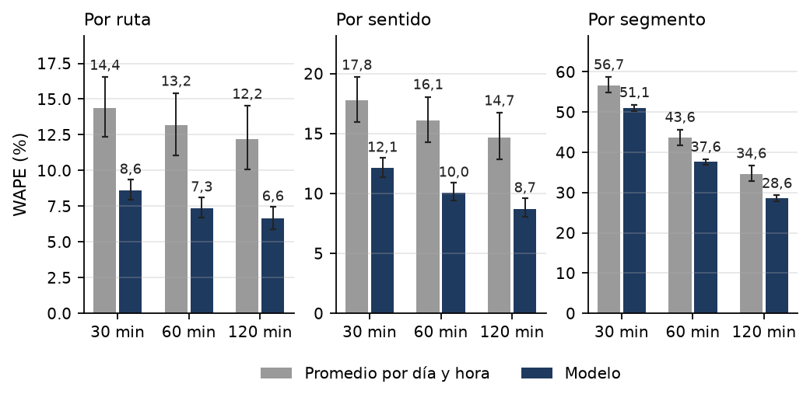
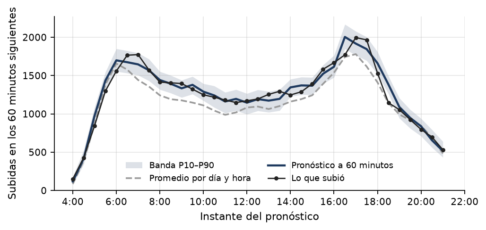
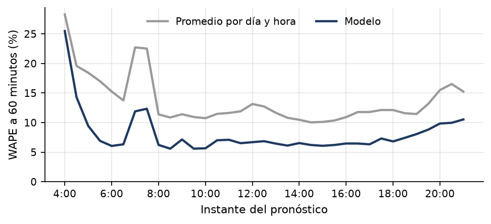
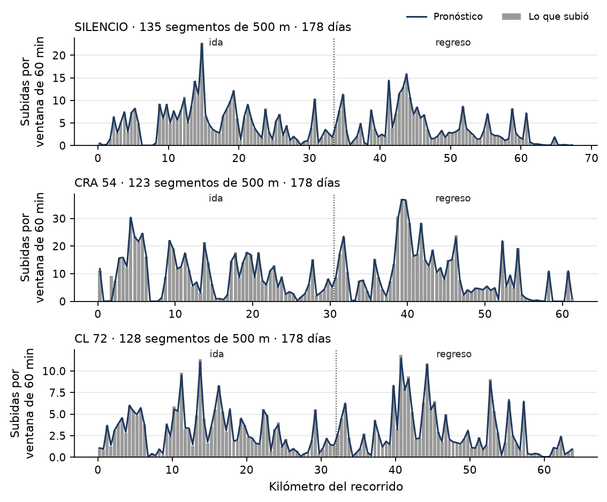
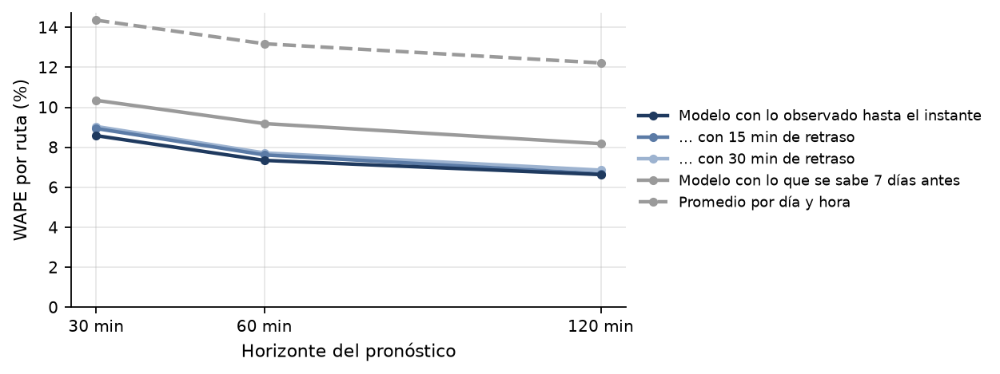

# Pronóstico de corto plazo por ruta, sentido y segmento

Este es el pronóstico que pide el enunciado: las subidas de los siguientes **30, 60 y 120 minutos**, por **ruta, sentido y segmento**, con lo observado hasta el instante del pronóstico. Se eligió con unos meses y se reportó, una sola vez, con otros.

**Resultado principal** (prueba de julio a diciembre de 2025, por ruta, a 60 minutos): el modelo se equivoca en **7,34 %** de las subidas y el promedio por día y hora, la línea base del enunciado, en 13,18 %. La diferencia es de −5,83 puntos, con IC del 95 % de −7,95 a −4,08.

## Por qué existe

La retroalimentación del curso del 17 de noviembre de 2026 señaló tres cosas de la entrega. Esto es lo que se hizo con cada una:

| Lo que se señaló | Lo que pide la especificación v1.5 | Lo que se hizo |
|---|---|---|
| El pronóstico era a siete días por ruta y hora de salida: no es el problema pedido, y sus cifras no se comparan con las de otros equipos | «Predecir la demanda para horizontes configurables de 30, 60 y 120 minutos» (§2.2, RF-005) «por ruta, sentido, segmento y franja horaria» (§3.1, §9.1) | Cada media hora se pronostican las subidas de los siguientes 30, 60 y 120 minutos, en los tres niveles, con MAE, RMSE, WAPE y sMAPE por ruta y franja |
| Los modelos se eligieron y se reportaron sobre los mismos meses de 2025 | «División cronológica en entrenamiento, validación y prueba reservada» (§9.3) | Se entrena con 2023 y 2024, se elige con enero a junio de 2025 y se reporta una vez con julio a diciembre de 2025. El protocolo se confirmó en git antes de entrenar |
| El modelo por segmento se entrenó con 37 días: lo espacial no quedó validado | Pronóstico y sesgo «por ruta, sentido, segmento» (§9.1, §9.3) | Subidas por segmento de los tres años con la regla de Extreme, verificada contra su tabla. El modelo por segmento se entrena con más de dos años y se prueba en seis meses: 2.404.780 celdas de segmento e instante |

El pronóstico a siete días del informe se conserva: es el que usa la programación semanal. Sus cifras no se comparan con las de aquí, porque son otro objetivo (pasajeros por hora de salida) y otro horizonte.

## El problema

- **Qué se pronostica.** En cada instante *t* (cada media hora, de 04:00 a 21:00: 35 instantes por día), las subidas de las ventanas [*t*, *t* + 30), [*t*, *t* + 60) y [*t*, *t* + 120).
- **A qué nivel.** La ruta (3), el sentido (ida y regreso) y el segmento: los 386 segmentos oficiales de 500 m de `rutas_segmentos` (135 en SILENCIO, 123 en CRA 54 y 128 en CL 72).
- **Con qué información.** Solo lo ocurrido antes de *t* y el calendario. Ninguna variable usa nada de *t* en adelante. Se comprobó cambiando el futuro: en 486 comprobaciones (2.792.508.924 valores comparados), las variables y las líneas base de las filas anteriores al cambio tuvieron 0 diferencias (`comprobar_fuga.py`, `resultados/comprobacion_fuga.json`).
- **Qué cuenta como subida.** Cada evento de conteo con subidas, en el bloque de 15 minutos del instante en que ocurrió, de todos los viajes.

## Los datos

La tabla `timbradas_segmentos` de la base del reto solo cubre del 2023-01-01 al 2023-02-27. Para tener los tres años se exportaron, en solo lectura, los 44.185.831 eventos de conteo con subidas (`exportar_eventos_subida.py`) y a cada uno se le asignó el segmento con la regla de Extreme: el segmento activo más cercano de su ruta (`preparar_panel.py`).

**La regla propia reproduce la tabla de Extreme** en los 58 días que la base trae (`panel/verificacion_extreme.json`):

| Comprobación | Resultado |
|---|---|
| Subidas de los 27.025 viajes de la tabla | 2.263.584 en la tabla de Extreme y 2.263.584 con la regla propia |
| Subidas que caen en el mismo segmento | 99,975 % |
| Celdas de viaje y segmento idénticas | 99,914 % de 1.024.273 |
| Viajes con el mismo total | 100 % |

El panel (`panel/subidas_segmento_15min.parquet`) tiene 44.871.165 subidas en 12.300.468 celdas de ruta, día, bloque de 15 minutos y segmento, del 2023-01-01 al 2025-12-31.

- **Días sin datos.** Un día de una ruta con menos del 5 % de las subidas habituales no se entrena ni se evalúa. Son 11 días por ruta: el último día de cada mes de febrero a diciembre de 2025, que la base no trae.
- **Sentido.** No viene en los datos. «Ida» es la primera mitad del ciclo y «regreso» la segunda, como en la API. En el 64 %–69 % del regreso la ida pasa a menos de 30 m, y la regla del segmento más cercano no mira en qué parte del viaje va el bus. Se midió cuánto afecta (`revisar_sentido.py`, `panel/revision_sentido.json`):

| Ruta | Regreso con la ida a menos de 30 m | Subidas en un segmento coherente con el tiempo de viaje (±45 min) | Subidas que quedarían mejor en el otro sentido |
|---|---|---|---|
| SILENCIO | 67,4 % | 80,8 % | 8,7 % |
| CRA 54 | 63,6 % | 92,1 % | 2,2 % |
| CL 72 | 68,6 % | 87,4 % | 5,3 % |

Se conserva la regla de Extreme porque es la definición oficial de la tabla. Las cifras por sentido llevan esa aproximación.

## Protocolo

Está en [`PROTOCOLO.md`](PROTOCOLO.md), escrito antes de entrenar. En resumen:

| Parte | Fechas | Para qué |
|---|---|---|
| Entrenamiento | 2023-01-01 a 2024-12-31 | ajustar los modelos |
| Validacion | 2025-01-01 a 2025-06-30 | elegir todo |
| Prueba | 2025-07-01 a 2025-12-31 | reportar, una sola vez |

El orden quedó en el historial de git del repositorio de entrega, en tres commits:

1. el protocolo, el código y el panel, sin resultados;
2. la validación y lo elegido (`resultados/validacion.json` y `resultados/seleccion.json`);
3. la prueba (`resultados/prueba.json`), calculada una sola vez con lo elegido y reentrenado con todo lo anterior al 1 de julio de 2025.

**Lo que hay que decir de 2025.** El equipo ya había usado esos meses en experimentos anteriores, con otro objetivo (pasajeros por hora de salida, a siete días). Ninguna decisión de este experimento usa julio a diciembre, pero no es una prueba ciega en sentido estricto. Se pidió a Extreme un periodo de 2026 para tenerla.

## Lo que se eligió, con la validación

Líneas base: el **promedio por día y hora** (la misma ventana en el mismo día de la semana de las 8 semanas anteriores) y la **última semana**, que son las del enunciado, y la **persistencia** (lo que subió en los mismos minutos justo antes). Candidato: LightGBM con pérdida de Poisson, un modelo por nivel, ruta y horizonte.

WAPE medio de los tres horizontes en la validación, en %:

| Nivel | Promedio por día y hora | Modelo: semanal | Modelo: con lo de hoy | Modelo: completo | Elegido |
|---|---|---|---|---|---|
| Ruta | 16,27 | 10,93 | 7,70 | 7,58 | completo |
| Sentido | 18,83 | 13,22 | 10,56 | 10,49 | completo |
| Segmento | 45,67 | 41,62 | 38,32 | 38,20 | completo |

- `semanal`: calendario y la misma ventana de las semanas anteriores. Es lo que se sabe con siete días de antelación.
- `con lo de hoy`: además, ayer, la última semana y lo observado hoy hasta el instante.
- `completo`: además, las salidas ya despachadas y, por segmento, lo observado en los segmentos vecinos y las salidas que llegarán al segmento en la ventana.

- **Hiperparámetros** (tres configuraciones fijadas de antemano): ruta, «base»; sentido, «árboles pequeños»; segmento, «árboles grandes».
- **Sentido:** la suma de sus segmentos (directo 10,44 %; suma de segmentos 10,13 %).
- **Segmento:** modelo directo (directo 38,14 %; conciliado 38,36 %; repartir el pronóstico de la ruta con las fracciones históricas, 41,91 %).
- **Banda P10–P90:** cuantiles conformales por tramo del pronóstico, ajustados con los errores de la validación.

## Resultados de la prueba

Julio a diciembre de 2025: 184 días, de los que 178 tienen datos en cada ruta. Todas las cifras salen de `resultados/prueba.json`.



**WAPE (%) de cada pronóstico sobre las mismas celdas**, con el IC del 95 % de la diferencia entre el modelo y el promedio por día y hora (bootstrap de bloques de 7 días, 2.000 réplicas) y la cobertura de la banda P10–P90 (objetivo: 80 %):

| Nivel | Horizonte | Promedio por día y hora | Última semana | Persistencia | **Modelo** | Modelo − promedio [IC 95 %] | Cobertura P10–P90 |
|---|---|---|---|---|---|---|---|
| Ruta | 30 min | 14,36 | 17,31 | 17,00 | **8,58** | −5,78 [−7,80; −4,08] | 81,4 % |
| Ruta | 60 min | 13,18 | 15,56 | 22,98 | **7,34** | −5,83 [−7,95; −4,08] | 82,8 % |
| Ruta | 120 min | 12,22 | 14,14 | 34,91 | **6,63** | −5,58 [−7,73; −3,80] | 83,8 % |
| Sentido | 30 min | 17,78 | 21,57 | 20,20 | **12,13** | −5,65 [−7,51; −3,99] | 80,8 % |
| Sentido | 60 min | 16,10 | 19,10 | 25,88 | **10,05** | −6,05 [−7,80; −4,60] | 81,3 % |
| Sentido | 120 min | 14,67 | 17,03 | 37,88 | **8,71** | −5,96 [−7,76; −4,46] | 83,2 % |
| Segmento | 30 min | 56,69 | 69,05 | 70,12 | **51,08** | −5,61 [−7,18; −4,18] | 79,4 % |
| Segmento | 60 min | 43,61 | 52,80 | 59,36 | **37,63** | −5,98 [−7,47; −4,74] | 79,7 % |
| Segmento | 120 min | 34,59 | 41,18 | 61,72 | **28,56** | −6,03 [−7,60; −4,76] | 80,0 % |

**Por ruta** (modelo; entre paréntesis, el promedio por día y hora):

| Ruta | Subidas medias en 60 min | WAPE 30 min | WAPE 60 min | WAPE 120 min | MAE 60 min | RMSE 60 min | sMAPE 60 min | Sesgo 60 min |
|---|---|---|---|---|---|---|---|---|
| SILENCIO | 580 | 8,20 (13,90) | 6,75 (12,64) | 5,85 (11,66) | 39,2 | 56,5 | 9,2 % | +1,03 % |
| CRA 54 | 1.171 | 8,03 (14,14) | 7,11 (13,20) | 6,71 (12,40) | 83,3 | 521,4 | 8,2 % | 0,00 % |
| CL 72 | 381 | 10,86 (15,73) | 8,97 (13,93) | 7,59 (12,51) | 34,2 | 45,7 | 11,6 % | +0,90 % |

**Por franja, a 60 minutos y por ruta** (las tres rutas juntas):

| Franja | Modelo | Promedio por día y hora | Sesgo del modelo |
|---|---|---|---|
| 04-05 | 9,34 % | 18,17 % | +2,02 % |
| 06-08 pico | 8,15 % | 16,35 % | −0,42 % |
| 09-16 valle | 6,44 % | 11,25 % | +0,71 % |
| 17-19 pico | 7,29 % | 12,01 % | +0,60 % |
| 20-21 | 10,06 % | 15,79 % | −1,05 % |
| **Pico** (06–08 y 17–19) | 7,75 % | 14,32 % | +0,06 % |
| **Valle** (el resto) | 7,07 % | 12,40 % | +0,70 % |

- **Por tipo de día** (60 minutos, por ruta): laboral, 6,47 % frente a 10,90 %; sábado, 10,12 % frente a 13,80 %; domingo o festivo, 10,43 % frente a 31,46 %.
- **Por mes** (60 minutos, por ruta): el modelo va de 6,50 % a 9,68 % y gana al promedio en 6 de los 6 meses.



El día de la figura es el 07-07-2025: el día laboral de la prueba con el error mediano del modelo en CRA 54 a 60 minutos (5,5 %; ese día el promedio por día y hora falla 10,3 %). Se eligió con esa regla para no escogerlo a ojo.



## Lo espacial: por sentido y por segmento



- **Por segmento.** En las 2.404.780 celdas de segmento e instante de la prueba, a 60 minutos, el modelo se equivoca en 37,63 % y el promedio por día y hora en 43,61 %. El error es alto en los dos porque cada celda trae pocas subidas: 5,5 en promedio.
- **Dónde gana.** El modelo gana al promedio en 332 de los 384 segmentos con subidas, que llevan el 99,1 % de las subidas.
- **Sesgo por segmento.** Su valor absoluto mediano es 2,5 %; ponderado por subidas, 2,3 %. En 276 segmentos queda por debajo del 5 %. El detalle de cada segmento está en `resultados/segmentos_prueba.csv`.

**Por sentido, a 60 minutos:**

| Ruta y sentido | Modelo | Promedio por día y hora | Sesgo del modelo |
|---|---|---|---|
| SILENCIO · ida | 10,21 % | 16,34 % | −0,16 % |
| SILENCIO · regreso | 11,69 % | 17,14 % | +0,91 % |
| CRA 54 · ida | 9,57 % | 17,32 % | −1,88 % |
| CRA 54 · regreso | 8,20 % | 13,66 % | +0,02 % |
| CL 72 · ida | 12,17 % | 16,96 % | −0,20 % |
| CL 72 · regreso | 12,65 % | 17,28 % | −0,10 % |

## Cuánto aporta lo observado en el día y cuánto cuesta que la captura llegue tarde

Dos análisis que el protocolo declaró de antemano, por ruta (WAPE en %):

| Horizonte | Promedio por día y hora | Modelo con lo que se sabe 7 días antes | Modelo elegido | … con 15 min de retraso | … con 30 min de retraso |
|---|---|---|---|---|---|
| 30 min | 14,36 | 10,35 | **8,58** | 8,94 | 9,04 |
| 60 min | 13,18 | 9,19 | **7,34** | 7,62 | 7,72 |
| 120 min | 12,22 | 8,18 | **6,63** | 6,67 | 6,86 |



- El mismo modelo con solo lo que se sabe una semana antes falla un 9,19 % a 60 minutos; con lo observado hasta el instante, un 7,34 %. Esa diferencia es lo que le faltaba al pronóstico a siete días para ser el del enunciado.
- Con 30 minutos de retraso en la captura, el error a 60 minutos es de 7,72 %; con 15 minutos, de 7,62 %.
- Las variables que más pesan en el modelo de ruta a 60 minutos (parte de la ganancia de los árboles): `p15` (lo que subió en los 15 minutos anteriores), 41 %; `m8` (el promedio de las 8 semanas anteriores), 13 %; `m4` (el de las 4 semanas), 11 %; `p30` (en los 30 anteriores), 8 %; `m7d` (la media de los 7 días anteriores), 4 %.

## Un registro imposible en los datos (análisis posterior a la prueba)

Al revisar la prueba, el RMSE por ruta salió varias veces mayor que el MAE (a 60 minutos, 303,9 frente a 52,2 subidas). La causa es un registro de conteo imposible que está en la base: el 05-07-2025 a las 07:45, **28.782 subidas en un solo segmento de CRA 54 en 15 minutos** (lo habitual en toda la ruta en ese bloque son 405). Hay otro en el entrenamiento: 97.157 subidas en CRA 54 el 26-05-2024. El panel conserva los registros tal como están en la base y el protocolo no previó filtrarlos, así que **las cifras de arriba lo incluyen y no se cambian**.

Para saber cuánto pesa, `sensibilidad_registro_anomalo.py` recalcula las métricas con las predicciones guardadas, sin entrenar ni pronosticar de nuevo. Les quita a todos los pronósticos los 9 días de CRA 54 en que el registro entra en el objetivo o en el promedio de ocho semanas: el 05-07-2025 y los ocho mismos días de la semana siguientes. No estaba en el protocolo: es un análisis posterior (`resultados/sensibilidad_registro_anomalo.json`).

| Nivel | Horizonte | Modelo: con el registro → sin esos días | Promedio por día y hora: con → sin | Modelo − promedio sin esos días [IC 95 %] | RMSE del modelo: con → sin |
|---|---|---|---|---|---|
| Ruta | 30 min | 8,58 → **8,18** | 14,36 → 13,68 | −5,50 [−7,50; −3,77] | 214,5 → 46,9 |
| Ruta | 60 min | 7,34 → **6,91** | 13,18 → 12,51 | −5,60 [−7,69; −3,82] | 303,9 → 73,7 |
| Ruta | 120 min | 6,63 → **6,16** | 12,22 → 11,55 | −5,40 [−7,52; −3,58] | 440,5 → 144,4 |
| Sentido | 30 min | 12,13 → **11,78** | 17,78 → 17,14 | −5,36 [−7,18; −3,67] | 167,0 → 77,9 |
| Sentido | 60 min | 10,05 → **9,69** | 16,10 → 15,45 | −5,77 [−7,52; −4,25] | 214,5 → 49,6 |
| Sentido | 120 min | 8,71 → **8,34** | 14,67 → 14,03 | −5,68 [−7,48; −4,15] | 306,4 → 84,4 |

La conclusión no cambia. Sin esos días bajan el error del modelo y el del promedio, y la diferencia por ruta a 60 minutos queda en −5,60 puntos (con el registro, −5,83). El RMSE sí cambia mucho, porque un solo error de unas 29.000 subidas pesa más que todos los demás juntos. Por segmento no se recalculó, porque las predicciones por segmento no se guardan; el registro está en el segmento 4 de CRA 54 y se ve en `resultados/segmentos_prueba.csv`.

## Limitaciones

- **El sentido es una aproximación** (la mitad del ciclo) y la regla del segmento más cercano deja una parte de las subidas en el sentido contrario (tabla de «Los datos»).
- **La prueba no es ciega en sentido estricto:** 2025 se conocía por los experimentos anteriores, aunque con otro objetivo.
- **Las subidas son demanda observada.** Dependen de los buses que pasaron: si no pasa bus, no hay subida. El modelo pronostica lo que se va a contar, no la gente que espera.
- **Supone que el conteo llega en vivo.** La especificación lo prevé (el disparador de conteo), pero la latencia real de la captura no se conoce; por eso se midió el efecto de 15 y 30 minutos de retraso.
- **No está integrado en la API.** La API pronostica hoy por hora de salida con su propio modelo. Llevar este a la API es el siguiente paso (`../PLAN_EVOLUCION.md`, sección 7).
- **Once días de 2025 sin eventos** (los últimos de mes) quedan fuera del entrenamiento y de la evaluación.
- **Los registros imposibles siguen en los datos.** El protocolo no previó filtrarlos: uno cae en el entrenamiento y otro en la prueba. Su efecto en la prueba está medido arriba; filtrarlos antes de entrenar es un pendiente.

## Cómo reproducirlo

Con las versiones de `../requirements_cuaderno.txt` (LightGBM 4.7.0, semilla 42), desde esta carpeta:

```
python validar.py           # elige con la validación: resultados/validacion.json y seleccion.json
python probar.py --repetir  # recalcula la prueba con lo elegido: resultados/prueba.json
python comprobar_fuga.py    # comprueba que ninguna variable usa el futuro: resultados/comprobacion_fuga.json
python figuras.py           # figuras/
python escribir_readme.py   # este archivo
```

`validar.py` y `probar.py` solo leen `panel/`, que viaja en la entrega. `exportar_eventos_subida.py` y `preparar_panel.py` arman `panel/` desde la base del reto y necesitan el acceso de solo lectura.

| Archivo | Qué es |
|---|---|
| `PROTOCOLO.md` | El problema, la partición, las reglas de elección y lo que se reporta, escrito antes de entrenar |
| `exportar_eventos_subida.py` | Exporta de la base, en solo lectura y por tramos, los eventos de conteo con subidas |
| `preparar_panel.py` | Asigna cada subida a su segmento y arma `panel/`; verifica contra la tabla de Extreme |
| `revisar_sentido.py` | Mide cuánto confunde el sentido la regla del segmento más cercano |
| `comprobar_fuga.py` | Cambia el futuro y comprueba que ninguna variable ni línea base anterior al cambio se mueve |
| `sensibilidad_registro_anomalo.py` | Análisis posterior a la prueba: las métricas sin los días que toca un registro imposible |
| `comun.py` | Datos, variables, líneas base, modelo, métricas e intervalos |
| `validar.py` · `probar.py` | La elección con la validación y el único cálculo de la prueba |
| `figuras.py` · `escribir_readme.py` | Las figuras y este archivo, desde `resultados/` |
| `panel/` | Subidas por segmento y bloque de 15 minutos, salidas, segmentos, calendario y las dos verificaciones |
| `resultados/` | `validacion.json`, `seleccion.json`, `prueba.json`, las predicciones por ruta y por sentido y el detalle por segmento |
